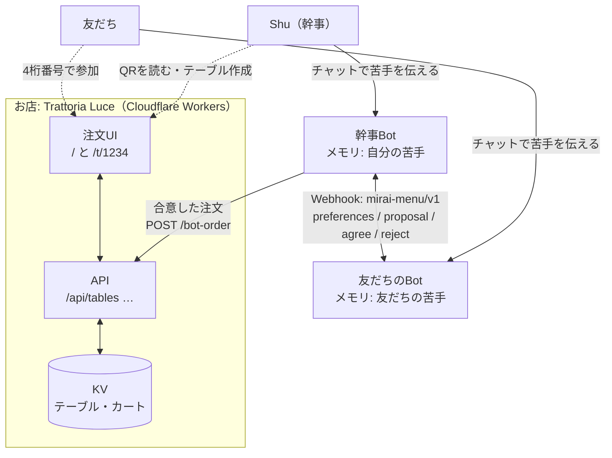
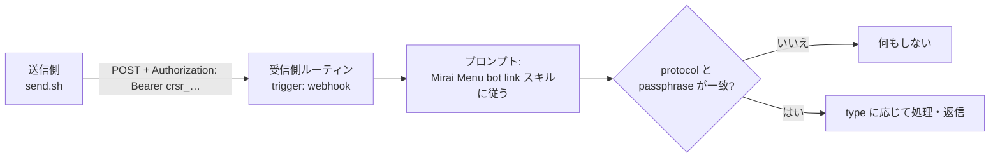
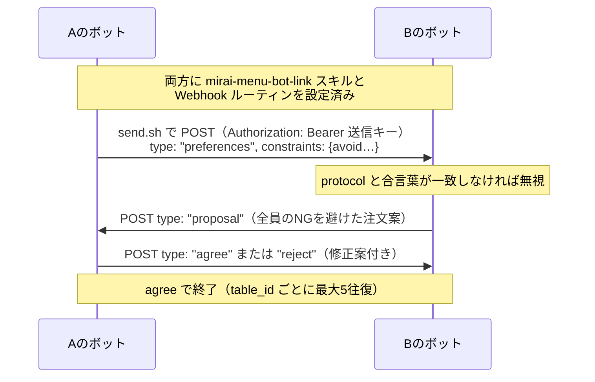
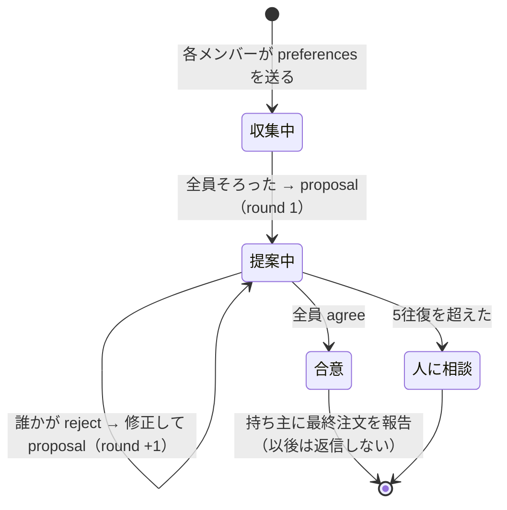
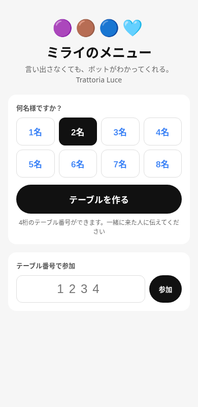
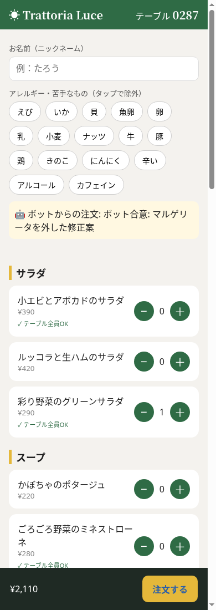
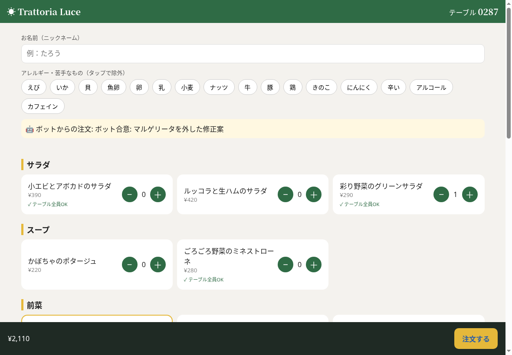
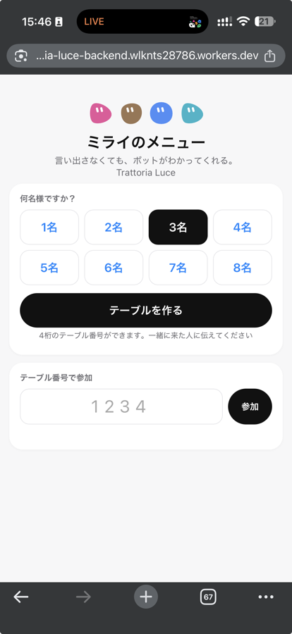
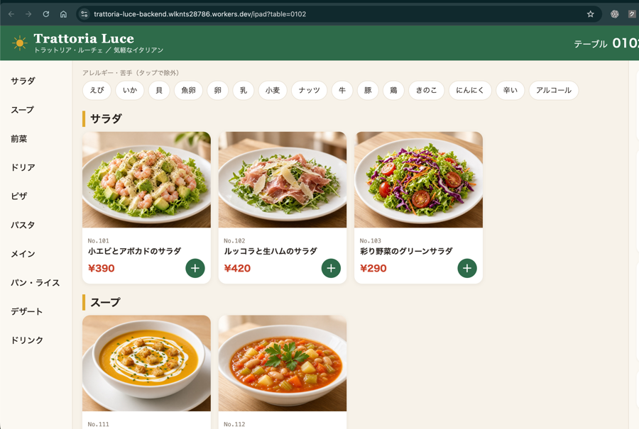
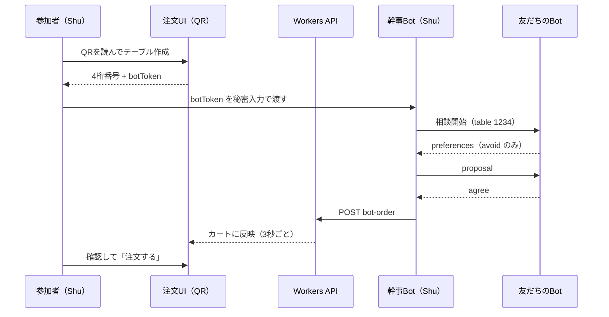

# ミライのメニュー を自分で作り直す ハンズオン教材

> 対象リポジトリ：[naru-sensei/mirai-menu](https://github.com/naru-sensei/mirai-menu)（Grok Bot Tokyo Hackathon / Team Null.）
>
> この教材は、上のリポジトリを読んで、Shu さんが自分の手で同じシステムを組み直せるように書いたものです。
>
> サンプルコードは `code/` フォルダにあります（フェーズごとに分かれています）。

---

## 0. この教材について

### 0-1. 作るもの

**「ひとりひとりのAIが、みんなの食卓をやさしくする。」**

- 自分の Grok Bot が、持ち主の **苦手な食材・アレルギー・飲めるお酒** を覚えている
- お店でテーブルの **QR を読む** と、同じテーブルの人のボットが集まって **こっそり相談** する（中身は相手に見せない）
- **全員が食べられる注文** がカートに入っている。言い出さなくても、ボットがわかってくれる


### 0-2. 全体アーキテクチャ



| 部品 | 元リポジトリ | この教材のフェーズ |
|---|---|---|
| ボットのメモリ（苦手・アレルギー・お酒） | README「しくみ」・スライド9〜12 | フェーズ1 |
| 共通スキル `mirai-menu-bot-link` ＋ Webhook ルーティン | `skill/SKILL.md`, `scripts/rimo-setup.md` | フェーズ2 |
| 送信スクリプトとメッセージ形式 `mirai-menu/v1` | `scripts/send.sh`, README「メッセージ形式」 | フェーズ3 |
| 交渉ループ（最大5往復・agree で終了） | `skill/SKILL.md`「On receiving」 | フェーズ4 |
| デモ店舗バックエンド（Cloudflare Workers） | README に説明のみ（**ソースは未収録**） | フェーズ5 |
| スマホ注文UI＋テーブルQR | `docs/*.png` のスクリーンショットのみ（**ソースは未収録**） | フェーズ6 |
| ボットテンプレート＋全体統合 | `bot-template/` | フェーズ7 |

> ⚠ **元リポジトリに無いもの**：Cloudflare Workers のバックエンドと注文UIのソースコードは公開リポジトリに入っていません（README の説明・スクリーンショット・公開URLだけ）。フェーズ5〜6は、それらから **設計し直した教材用の実装** です。API の形やメニュー内容は推測で、オリジナルと同じではありません。

### 0-3. フェーズ一覧

| フェーズ | ゴール（一言） | 目安 |
|---|---|---|
| 1 | 自分のボットが苦手・アレルギー・お酒を覚え、「送ってよい形」で答えられる | 20分 |
| 2 | 共通スキルと Webhook ルーティンを入れ、自分宛てのセルフテストが HTTP 200 になる | 30分 |
| 3 | `send.sh` でプロトコル通りのメッセージを送り、相手のボットが起きる | 40分 |
| 4 | 2体以上のボットが preferences → proposal → agree まで自動で進む（5往復以内） | 60分 |
| 5 | Cloudflare Workers にテーブル・カート API をデプロイできる | 60分 |
| 6 | スマホで QR を読み、テーブル作成・参加・アレルゲン除外・カート同期ができる | 60分 |
| 7 | ボットテンプレートで新しいボットが参加でき、合意した注文がテーブルのカートに入る | 60分 |

### 0-4. 守るルール（プライバシーと秘密情報）

この教材ではずっと、次の3つを守ります。**ゴールの確認項目にも毎回入れます。**

1. **送るのは「避けるもの」だけ**。相手のボットやお店には `avoid`（タグ）・`allergy`（厳守かどうか）・`drinks`（飲み物の希望）だけを送る。**名前・理由・病名・体質の詳細は送らない。**
2. **秘密はチャットに貼らない**。Webhook URL・送信キー・合言葉・テーブルトークンは、ボットの **秘密入力（シークレット）** から環境変数（`MIRAI_PEER_URL` など）として渡す。X の投稿や公開チャット、Git にも入れない。
3. **合言葉が違うメッセージは無視する**。返信もしない。

---

## 前提条件

| 必要なもの | 用途 | 確認方法 |
|---|---|---|
| Grok Bot（メモリ・スキル・ルーティン・秘密入力が使えること） | フェーズ1〜4, 7 | ボットにチャットできる |
| 一緒に試す相手（もう1人の Grok Bot、または自分の2体目） | フェーズ3〜4 | 相手と非公開で連絡できる（DM など） |
| `bash`・`curl`・`jq` | フェーズ3, 7 | `jq --version` |
| Node.js **22 以上** | フェーズ4〜6（wrangler 4 は Node 22 以上が必要） | `node --version` |
| Cloudflare アカウント（無料プランで可） | フェーズ5〜6 | ダッシュボードにログインできる |
| スマホ（QR を読むため） | フェーズ6 | カメラで QR が読める |

教材のファイル構成：

```text
mirai-menu-tutorial/
├── 教材.md / 教材.pdf
├── images/                         # 図・スクリーンショット
└── code/
    ├── phase1/onboarding-prompts.md     # ボットに覚えさせる会話例
    ├── phase1/preferences.schema.json   # 「送ってよい情報」の形
    ├── phase2/mirai-menu-bot-link.SKILL.md  # 共通スキル（元リポジトリと同じ）
    ├── phase2/routine-prompt.md         # Webhook ルーティンのプロンプト
    ├── phase2/self-test.json            # 自分宛てテスト用メッセージ
    ├── phase3/send.sh                   # 送信スクリプト（元リポジトリと同じ）
    ├── phase3/mock-peer.mjs             # ローカル専用の「相手のwebhook」もどき
    ├── phase3/msgs/*.json               # preferences / proposal / agree / reject の例
    ├── phase4/negotiate.mjs             # 交渉ループのシミュレーター
    ├── phase5-6-trattoria-luce/         # Workers バックエンド＋注文UI
    └── phase7/                          # カート連携スキル・スクリプト・完成版ルーティン
```

---

## フェーズ1：ボットに「好み」を覚えさせる

### ゴール

- [ ] **新しいチャット**で「私が避けたい食材を avoid の形で並べて」と聞くと、ボットが `avoid: ["えび", "貝", "きのこ"]` のように **タグで** 答える
- [ ] 「相手に送ってよい情報／送ってはいけない情報」を聞くと、名前・理由・健康情報は **送らない** 側に入っている
- [ ] 内容を訂正すると、次に聞いたときの答えに反映されている

### 学ぶこと

- Grok Bot の **メモリ**：チャットで伝えたことを、別の会話でも覚えている
- **共通語彙（タグ）** の大切さ：「甲殻類」「えび・かに」「shrimp」がバラバラだと、ボット同士もお店も照合できない。この教材では注文UIのチップと同じ16個のタグを使います

  `えび / いか / 貝 / 魚卵 / 卵 / 乳 / 小麦 / ナッツ / 牛 / 豚 / 鶏 / きのこ / にんにく / 辛い / アルコール / カフェイン`

- 「本当の情報（メモリ）」と「外に出す情報（constraints）」を分ける考え方

### 手順

1. ボットとのチャットで、自分の好みを伝えます（`code/phase1/onboarding-prompts.md` の例をそのまま使えます）。

   ```text
   私の食事の好みを覚えておいて。
   - 食べられない（アレルギー）：えび・かに（甲殻類）
   - 苦手：生ガキ、きのこ
   - お酒：ビールは1杯まで。そのあとはノンアルコール
   これは「ミライのメニュー」で、ほかの人のボットと注文を相談するときに使います。
   ```

2. 続けて、プライバシーのルールも覚えさせます。

   ```text
   ほかの人やボットに伝えるときは「避ける食材のタグ」と「飲み物の希望」だけにして。
   タグは えび/いか/貝/魚卵/卵/乳/小麦/ナッツ/牛/豚/鶏/きのこ/にんにく/辛い/アルコール/カフェイン から選んで。
   私の名前、理由（アレルギーなのか好みなのか）、健康の詳しい話は送らないで。
   ```

3. 外に出す情報の「形」を決めておきます。`code/phase1/preferences.schema.json` がその定義です（`additionalProperties: false` で、余計な項目＝個人情報が混ざらないようにしています）。

   ```json
   { "avoid": ["えび", "貝", "きのこ"], "allergy": true, "drinks": "ビール1杯まで、あとはノンアル" }
   ```

4. （発展）**同じアカウント内で複数ボット**を作ると、元チームの「同一アカウント内の実証」を再現できます。幹事Bot＋飲み会メンバーA/B/C を作り、各メンバーに別々の苦手を覚えさせ、幹事Botに「みんなに何が食べたいか聞いて」と頼みます（スライド9〜13）。

   

### 確認方法

- **新しいチャット**を開き、`code/phase1/onboarding-prompts.md` の「3. 確認用」の質問をします。
- 期待する答え：`avoid: ["えび", "貝", "きのこ"] / allergy: true / drinks: "ビール1杯まで、あとはノンアル"`。生ガキは「貝」タグに、甲殻類は「えび」タグにまとまっていれば OK。
- 「訂正：きのこは大丈夫になりました。代わりに乳製品がダメです」と送り、もう一度聞いて `きのこ` が消え `乳` が増えていれば OK。

### つまずきポイント

- **同じ会話の中だけで覚えている**：同じチャットで聞き返すと、メモリではなく会話の流れで答えていることがあります。必ず **新しいチャット** で確認しましょう。
- **タグが自由文になる**：「甲殻類全般」などと答えたら、「16個のタグから選んで」と言い直します。フェーズ5でお店のメニューと照合するときに効いてきます。
- **アレルギーと苦手の区別**：`allergy: true` は「厳守」の印です。病名は書きません。
- 実在の人のアレルギー情報を、リポジトリやスクリーンショットに残さないこと（元リポジトリもデモ用ボットのデータだけを使っています）。

---

## フェーズ2：共通スキルと Webhook ルーティン

### ゴール

- [ ] 自分のボットにスキル **Mirai Menu bot link**（`mirai-menu-bot-link`）が入っている
- [ ] トリガーが `{ "type": "webhook" }` のルーティン「ミライのメニュー連携」があり、その **Webhook URL と送信キー** をルーティンパネルから取り出せる
- [ ] 自分の URL とキーを（チャットではなく）秘密として `MIRAI_PEER_URL` / `MIRAI_PEER_KEY`、合言葉を `MIRAI_PASSPHRASE` に入れ、**自分宛てのセルフテスト** が `HTTP 200` / `{"success":true}` になり、ルーティンが起動する

### 学ぶこと

- **スキル**＝ボットが従う手順書。両方のボットに同じスキルを入れることで「共通プロトコル」になる
- **ルーティン（Webhook トリガー）**＝ボットの「受信箱」。URL に POST されるとボットが起きて、プロンプトに従って処理する
- **送信キー**（`Bearer crsr_...` の形）は、その受信箱に投函するための鍵。持っている人は誰でも投函できるので秘密



### 手順

1. **スキルを入れる**：`code/phase2/mirai-menu-bot-link.SKILL.md`（元リポジトリの `skill/SKILL.md` と同一）をボットに渡し、スキルとして登録してもらいます。

   ```text
   このファイルを「Mirai Menu bot link」というスキルとして登録して。中身は変えないで。
   ```

   スキルの要点（英語の原文を日本語でまとめたもの）：
   - メッセージは JSON。`protocol: "mirai-menu/v1"`・`passphrase`・`from_bot`・`table_id`・`type`・`constraints`・`proposal`・`note`
   - 受信したら：protocol か passphrase が違えば **無視**。`preferences` → 自分の持ち主の制約と合わせて `proposal` を返す。`proposal` → 全部OKなら `agree`、ダメなら修正案つきで `reject`。`agree` → 持ち主に最終注文を伝えて **終了**。`table_id` ごとに最大5往復
   - 送信は `/workspace/mirai/send.sh msg.json`。メッセージ全体を JSON 文字列にして `context` にも入れる（受信側のプロンプトに確実に届くフィールドのため）

2. **ルーティンを作る**：ボットに頼みます（`code/phase2/routine-prompt.md`）。

   ```text
   webhook トリガーのルーティンを作って。名前は「ミライのメニュー連携」。
   トリガーは { "type": "webhook" }。
   プロンプトは「When a Mirai Menu message arrives, follow the Mirai Menu bot link skill.」
   ```

3. **URL とキーを取り出す**：ルーティンを保存したら、ルーティンパネルから **Webhook URL** と **送信キー**（`Bearer crsr_...` と表示される）をコピーします。**どこにも貼らずに**、パスワードマネージャーなどに一時保管します。

4. **送信スクリプトをボットの作業場所に置く**：スキルは `/workspace/mirai/send.sh` を使う前提です。

   ```text
   https://raw.githubusercontent.com/naru-sensei/mirai-menu/main/scripts/send.sh を
   /workspace/mirai/send.sh に保存して、実行権限をつけて。中身は変えないで。
   ```

5. **秘密を設定する（セルフテスト用）**：まず「相手＝自分」にしてテストします。ボットに「秘密入力で `MIRAI_PEER_URL` と `MIRAI_PEER_KEY` と `MIRAI_PASSPHRASE` を受け取って」と頼み、表示される入力欄に入れます。
   - `MIRAI_PEER_URL`：手順3の自分の Webhook URL
   - `MIRAI_PEER_KEY`：`crsr_...` の部分だけ（`Bearer ` は付けない、**末尾に改行を入れない**）
   - `MIRAI_PASSPHRASE`：好きな合言葉（フェーズ3で相手と同じ値にする）

6. **セルフテスト**：`code/phase2/self-test.json`（合言葉の部分はボットが `MIRAI_PASSPHRASE` で置き換える）を送ってもらいます。

   ```text
   self-test.json の passphrase を MIRAI_PASSPHRASE の値に置き換えて、
   /workspace/mirai/send.sh で送って。キーやURLは表示しないで。結果の HTTP コードだけ教えて。
   ```

### 確認方法

- 送信側の出力が `HTTP 200` と `{"success":true}` になる
- ルーティンの実行履歴に、新しい実行が1件増えている（＝ボットが起きた）
- 実行の中でボットが「self-test から preferences を受信した」と報告している
- 合言葉をわざと変えたメッセージを送ると、ルーティンは起動しても **何も返さない**

### つまずきポイント

| 症状 | 原因 | 対処 |
|---|---|---|
| `HTTP 400` | キーや URL の末尾に改行が入っている／JSON が壊れている | 改行なしで入れ直す。`send.sh` は `\r\n` を削るが、秘密入力側の値も確認 |
| `HTTP 401` | キーが違う・古い | ルーティンパネルで送信キーを再生成し、`MIRAI_PEER_KEY` を更新 |
| 200 なのにボットが中身を読めていない | 受信イベントのトップレベルに項目が届いていない | スキル通り `context`（JSON文字列）から読むようにプロンプトで念押し |
| キーをチャットに貼ってしまった | — | すぐ再生成する。チャット履歴は消えない前提で考える |

> 注：スキルの末尾にもある通り、エンドポイントとヘッダーの形式は「Cursor Automations の webhook を元にした」もので、仕様が変わる可能性があります。**必ずセルフテストで確かめてから** 相手とつなぎましょう。

---

## フェーズ3：`send.sh` とプロトコルで2体のボットをつなぐ

### ゴール

- [ ] ローカルのモック（`mock-peer.mjs`）に対して、`send.sh` で4種類のメッセージ（preferences / proposal / agree / reject）を送り、すべて `HTTP 200` になる
- [ ] 間違ったキーで `HTTP 401` と `hint: regenerate sender key` が出ることを確認できる
- [ ] 相手（友だちのボット、または自分の2体目）と URL・キーを **非公開で** 交換し、A → B の `preferences` で B のルーティンが起動し、B から `proposal` が返ってくる

### 学ぶこと

- `send.sh` が何をしているか（秘密を表示しない工夫）
- メッセージ形式 `mirai-menu/v1` と、各フィールドの意味
- 「両方向」につなぐには、**お互いの** URL とキーが必要



### 手順

1. **`send.sh` を読む**（`code/phase3/send.sh`、元リポジトリと同一）。ポイント：

   ```bash
   : "${MIRAI_PEER_URL:?MIRAI_PEER_URL not set}"            # 環境変数が無ければ止まる
   KEY="$(printf %s "$MIRAI_PEER_KEY" | tr -d '\r\n')"; KEY="${KEY#Bearer }"   # 改行と "Bearer " を除去
   BODY="$(echo "$MSG" | jq -c '. + {context: (del(.context)|tojson)}')"       # 全体を context にも複製
   printf 'Authorization: Bearer %s\n' "$KEY" > "$HDR"       # キーはファイル経由で渡す（ps に出ない）
   echo "response: $(head -c 300 "$OUT" | sed "s/$KEY/***/g")" # エラー表示でもキーを伏せる
   ```

   - キーをコマンドライン引数に直接書かず、一時ファイル（`-H @file`）で渡しているので、`ps` などのプロセス一覧に出ません。
   - `context` に同じ内容を JSON 文字列で入れるのは、受信側のプロンプトに確実に届けるためです。

2. **ローカルで練習する（外部に一切つながらない）**：

   ```bash
   cd code/phase3
   # ターミナル1：相手のwebhookのモック
   MOCK_KEY=crsr_test PASSPHRASE=test-pass node mock-peer.mjs

   # ターミナル2：送信
   export MIRAI_PEER_URL=http://127.0.0.1:8788/webhook
   export MIRAI_PEER_KEY="Bearer crsr_test"     # "Bearer " 付きでも send.sh が外す
   sed 's/REPLACE_WITH_PASSPHRASE/test-pass/' msgs/preferences.json > /tmp/p.json
   ./send.sh /tmp/p.json
   ```

   実行例：

   ```text
   HTTP 200
   {"success":true}
   # モック側
   [mock] preferences from=飲み会メンバーA table=trattoria-luce/0102 {"avoid":["えび"],"allergy":true,"drinks":"なんでもOK"}
   [mock] context フィールド: あり
   ```

3. **失敗パターンを体験する**：

   ```bash
   MIRAI_PEER_KEY=crsr_bad ./send.sh /tmp/p.json          # → HTTP 401 / hint: regenerate sender key
   ./send.sh msgs/agree.json                              # 合言葉が違う → 200 だがモックは「無視しました」
   jq '. + {owner_name:"山田"}' /tmp/p.json | ./send.sh    # モックが「未定義のフィールド」と警告
   ```

   最後の例は **プライバシー違反の検出** です。プロトコルに無い項目（名前など）が混ざったら気づけるようにしておきます。

4. **メッセージ形式を確認する**（`code/phase3/msgs/`）：

   | type | 送る人 | 必須の中身 | 意味 |
   |---|---|---|---|
   | `preferences` | 各メンバー → 幹事（または相手） | `constraints` | 自分の「避けるもの」を伝える |
   | `proposal` | 幹事 → 各メンバー | `proposal`（料理名の配列） | 全員のNGを避けた注文案 |
   | `agree` | 各メンバー → 幹事、幹事 → 全員 | `proposal`（合意した案） | OK。これで終了 |
   | `reject` | 各メンバー → 幹事 | `proposal`（修正案）、必要なら最新の `constraints` | 食べられないものがある |

   `table_id` は「お店/テーブル」や「イベント」のID（例 `trattoria-luce/0102`）。**往復回数は table_id ごとに数えます。**

5. **本物の相手とつなぐ**（`scripts/rimo-setup.md` の流れ）：
   1. 相手もフェーズ2までを済ませる
   2. お互いの **Webhook URL と送信キー** を DM など **非公開** で渡す（公開チャットや X には貼らない）
   3. それぞれ、**相手の** URL とキーを `MIRAI_PEER_URL` / `MIRAI_PEER_KEY` に秘密入力で入れ直す。`MIRAI_PASSPHRASE` は **2人で同じ値** にする
   4. A が `preferences` を送る：

      ```text
      私の constraints で preferences を作って、table_id は "test/0001" で相手に送って。
      ```

### 確認方法

- ローカル：4種類すべて `HTTP 200`、401 のヒント表示、未定義フィールドの警告が出る
- 本番：B のルーティン実行履歴に1件増え、A のルーティンにも B からの `proposal` で1件増える
- B が受け取った内容に、A の名前・理由が含まれていない（B の持ち主に「何を受け取った？」と聞いて確認）

### つまずきポイント

- **片方向だけつながる**：A に B の URL、B に A の URL が入っているか確認（自分の URL を入れたままだと、自分に送り返してしまう）。
- **`jq required`**：ボットの作業環境に `jq` が無いときは、ボットに入れてもらう。
- **ループ**：両方が `agree` に `agree` で返すと止まりません。スキル通り「agree の後は返信しない」をプロンプトで念押し。
- `note` 欄も相手に見えます。「甲殻類アレルギーで入院したことがある」のような理由は書かない。

---

## フェーズ4：交渉ループ（preferences → proposal → agree / reject）

### ゴール

- [ ] シミュレーター `negotiate.mjs` の3シナリオ（normal / correction / intruder）がすべて `exit 0`（合意・全員食べられる・理由の漏えいなし）
- [ ] 本物のボット2体以上で、`preferences` から始めて **5往復以内に `agree`** で止まり、両方の持ち主に同じ最終注文が届く
- [ ] 途中で持ち主が訂正すると、`reject` → 修正案 → `agree` になる。合言葉違いのメッセージは無視される

### 学ぶこと

- 交渉を **状態機械** として考える（どの type が来たら、何を返し、いつ止まるか）
- 全員の `avoid` の **和集合** を避ければ、全員が食べられる
- LLM のボットに任せる前に、**ルールをコードで確かめる** と、ボットの挙動の良し悪しを判定できる



### 手順

1. **シミュレーターを動かす**（webhook は使わず、メモリ上のキューでやりとり）：

   ```bash
   cd code/phase4
   node negotiate.mjs            # 通常
   node negotiate.mjs correction # 途中でBの持ち主が「乳製品もダメ」と訂正
   node negotiate.mjs intruder   # 合言葉の違うメッセージが混ざる
   ```

   correction の実行例：

   ```text
   幹事Bot: 飲み会メンバーA の避けるもの = えび
   幹事Bot: 飲み会メンバーB の避けるもの = 貝・きのこ
   幹事Bot: 飲み会メンバーC の避けるもの = なし
   幹事Bot: round 1 提案 → ルッコラと生ハムのサラダ、スパイシーチキンウィング、マルゲリータ、…
   （Bの持ち主がチャットで訂正：「乳製品もダメでした」）
   幹事Bot: round 2 提案 → 彩り野菜のグリーンサラダ、スパイシーチキンウィング、ペペロンチーノ、…
   幹事Bot: 全員 agree（2往復）→ カートへ
   チェック: 合意=true / 全員食べられる=true / 往復数=2 / 理由の漏えいなし=true
   ```

2. **コードの読みどころ**（`negotiate.mjs`）：

   ```js
   // 外に出すのは避けるタグと飲み物の希望だけ
   constraints() { return { avoid: this.memory.avoid, allergy: this.memory.allergy, drinks: this.memory.drinks }; }

   // 幹事：全員の avoid の和集合を避けて、カテゴリごとに1品ずつ選ぶ
   const avoid = [...new Set(Object.values(this.prefs).flatMap((c) => c.avoid))];
   const ok = safeMenu(avoid);

   // 5往復を超えたら人に戻す
   if (++this.round > MAX_ROUNDS) { this.done = true; … }
   ```

   `memory.reason`（「甲殻類アレルギー」）は外に出していないことを、最後のチェックで確かめています。

3. **自分で改造してみる**（練習問題）：
   - メンバーDを追加（`avoid: ["小麦"]`）して、ピザとパスタが消えることを確認
   - C の「ビール1杯まで」を正しく扱う（1杯目だけ生ビール、2杯目以降はノンアル）
   - 「全員が避けるものを避けると何も残らない」場合に、`reject` ではなく人に相談する分岐を足す

4. **本物のボットで交渉する**：フェーズ3でつないだ2体で、A（幹事役）に頼みます。

   ```text
   table_id "test/0002" で、相手のボットとミライのメニューの相談をして。
   まず相手に preferences を送ってもらい、そろったら proposal を出して。
   メニューは code/phase5-6-trattoria-luce/src/menu.js の料理から選んで。
   ```

   3体以上（幹事＋メンバー複数）でやる場合は、メンバーごとに URL・キーが必要です（`MIRAI_PEER_URL_B` のように分けるか、幹事Botに相手ごとの秘密を持たせる）。

### 確認方法

- シミュレーター：3シナリオすべて最終行が `合意=true / 全員食べられる=true / … / 理由の漏えいなし=true`、`echo $?` が `0`
- 本番：
  - 両方のルーティン実行回数の合計が **10回以内**（5往復）で止まっている
  - 両方の持ち主のチャットに、同じ最終注文が届いている
  - 最終注文に、どちらかの `avoid` に当たる料理が入っていない（`menu.js` のタグで照合）
  - B の持ち主に「きのこは大丈夫、代わりに乳がダメ」と訂正してもらい、もう一度 `test/0003` でやり直すと、乳を含む料理が消えている

### つまずきポイント

- **止まらない**：`agree` を受けたら返信しない／往復数を table_id ごとに数える、をプロンプトに明記。テストのたびに新しい `table_id` を使う。
- **料理名の表記ゆれ**：「マルゲリータ」と「マルゲリータピザ」で照合に失敗します。メニューの正式名（または ID）を使うよう指示します。フェーズ7のカート連携で効いてきます。
- **ボットが理由を添えてしまう**：「Aさんは甲殻類アレルギーなので」と `note` に書いてしまうことがあります。スキルの Privacy 行を読み直させ、`note` は短い事務連絡だけにします。
- **ボットが「推測」で食べられると判断する**：タグに無い食材（例：アンチョビ）は判断できません。分からない料理は避ける、という保守的なルールにします。

---

## フェーズ5：デモ店舗バックエンド（Cloudflare Workers）

> ⚠ 元リポジトリには Workers のソースがありません。ここは README の「仮想店舗のバックエンド：デモ用レストラン Trattoria Luce の注文システム（Cloudflare Workers）」と、スクリーンショット（人数選択・テーブル作成・4桁番号で参加・`/ipad?table=0102`・アレルゲンチップ）から **設計し直した** ものです。

### ゴール

- [ ] `npm test` が通る（wrangler なしで API の動きを検証）
- [ ] `npx wrangler dev` で起動し、curl で **テーブル作成 → 参加 → カート追加 → 確定** ができる
- [ ] 公開ビュー（`GET /api/tables/:code`）に、**誰が何を避けるか** と **botToken** が出ていない
- [ ] `npx wrangler deploy` で `https://trattoria-luce-backend.<あなたのサブドメイン>.workers.dev` に公開される

### 学ぶこと

- Cloudflare Workers の `fetch` ハンドラーと、**静的アセット**（`[assets]`）＋ **KV** の組み合わせ
- 4桁のテーブル番号・6時間で消える（`expirationTtl`）一時データ
- **プライバシーを API 設計で守る**：個人の `avoid` は保存しても、外に返すのはテーブル全体の **和集合だけ**

### API 設計

| メソッド・パス | 用途 | 返すもの |
|---|---|---|
| `GET /api/menu?avoid=えび,乳` | メニュー（avoid 指定で除外済み） | `tags`, `categories`, `items` |
| `POST /api/tables` `{size}` | テーブル作成 | `code`（4桁）, `botToken`（作成者に1回だけ） |
| `GET /api/tables/:code` | テーブルの公開ビュー | 人数・ニックネーム・`avoidUnion`・カート・合計 |
| `POST /api/tables/:code/join` `{nickname, avoid}` | 参加 | `memberId` |
| `PUT /api/tables/:code/members/:id` `{avoid}` | 苦手の訂正 | 公開ビュー |
| `POST /api/tables/:code/cart` `{itemId, delta}` | カートの増減 | 公開ビュー＋`warning` |
| `POST /api/tables/:code/bot-order` | ボットが合意した注文を入れる（フェーズ7） | 公開ビュー（NG があれば 409） |
| `POST /api/tables/:code/submit` | 注文確定 | 公開ビュー |

### 手順

1. **プロジェクトを用意**：

   ```bash
   cd code/phase5-6-trattoria-luce
   npm install            # wrangler と qrcode が入る
   npm test               # KV をメモリで代用したテスト
   ```

   ```text
   # tests 1
   # pass 1
   ```

2. **メニューとタグ**（`src/menu.js`）。タグはフェーズ1の16語と同じです。

   ```js
   export const MENU = [
     { id: 101, cat: "サラダ", name: "小エビとアボカドのサラダ", price: 390, tags: ["えび", "卵"] },
     { id: 103, cat: "サラダ", name: "彩り野菜のグリーンサラダ", price: 290, tags: [] },
     { id: 201, cat: "前菜", name: "スパイシーチキンウィング", price: 320, tags: ["鶏", "辛い", "にんにく"], star: true },
     // …（全27品。スクリーンショットにあった6品＋教材用に追加した料理）
   ];
   export function safeMenu(avoid = []) {
     const ng = new Set(avoid);
     return MENU.filter((m) => !m.tags.some((t) => ng.has(t)));
   }
   ```

3. **Worker 本体**（`src/index.js`）の要点：

   ```js
   // テーブル全体の「避けるもの」= 全員の avoid の和集合。誰の NG かは返さない
   const avoidUnion = (t) => [...new Set(Object.values(t.members).flatMap((m) => m.avoid))].sort();

   // 未知のタグは捨てる（自由文の個人情報が紛れ込まないように）
   const cleanAvoid = (avoid) => [...new Set((Array.isArray(avoid) ? avoid : []).filter((t) => TAGS.includes(t)))];

   // /api/* 以外は静的アセット。/t/1234 と /ipad?table=1234 は同じ order.html
   if (/^\/t\/\d{4}$/.test(url.pathname) || url.pathname === "/ipad") {
     return env.ASSETS.fetch(new Request(new URL("/order", url), req));
   }
   ```

4. **設定**（`wrangler.toml`）と KV の作成：

   ```toml
   name = "trattoria-luce-backend"
   main = "src/index.js"
   compatibility_date = "2026-10-01"

   [assets]
   directory = "./public"
   binding = "ASSETS"

   [[kv_namespaces]]
   binding = "TABLES"
   id = "REPLACE_WITH_YOUR_KV_ID"
   ```

   ```bash
   npx wrangler login
   npx wrangler kv namespace create TABLES   # 表示された id を wrangler.toml に貼る
   ```

5. **ローカルで動かす**：

   ```bash
   npx wrangler dev          # http://localhost:8787 （KV はローカルの模擬環境）
   ```

   別のターミナルで：

   ```bash
   B=http://localhost:8787
   T=$(curl -s -X POST $B/api/tables -H 'content-type: application/json' -d '{"size":3}')
   C=$(echo $T | jq -r .code); echo "テーブル $C"
   curl -s -X POST $B/api/tables/$C/join -H 'content-type: application/json' -d '{"nickname":"A","avoid":["えび"]}' | jq .table.avoidUnion
   curl -s -X POST $B/api/tables/$C/join -H 'content-type: application/json' -d '{"nickname":"B","avoid":["貝","きのこ"]}' | jq .table.avoidUnion
   curl -s -X POST $B/api/tables/$C/cart -H 'content-type: application/json' -d '{"itemId":101,"delta":1}' | jq '{warning, total: .table.total}'
   curl -s $B/api/tables/$C | jq .
   curl -s -X POST $B/api/tables/$C/submit | jq .table.status
   ```

   期待する出力（抜粋）：

   ```text
   ["えび"]
   ["えび","きのこ","貝"]
   {"warning":"テーブルの誰かが避けたいもの（えび）を含みます","total":390}
   "ordered"
   ```

6. **デプロイ**：

   ```bash
   npx wrangler deploy
   # → https://trattoria-luce-backend.<subdomain>.workers.dev
   ```

### 確認方法

- `npm test` が pass
- 手順5の出力が期待通り。`curl -s $B/api/tables/$C | jq .` の結果に `members` と `botToken` が **無い**
- `curl -s -o /dev/null -w '%{http_code}\n' $B/api/tables/0000` が `404`
- デプロイ後の URL でも同じ curl が動く

### つまずきポイント

- **`Wrangler requires at least Node.js v22`**：Node 22 以上に上げる（`nvm install 22` など）。
- **KV の id を入れ忘れ**：`wrangler dev` はローカル模擬なので動いてしまい、`deploy` で初めて失敗します。
- **KV は「結果整合」**：同時に2人がカートを押すと、片方の更新が消えることがあります（読んで→書く、の間に割り込まれる）。デモには十分ですが、本番では **Durable Objects**（テーブルごとに1つ）に置き換えるのが定石です（練習問題）。
- **人数が少ないと和集合でも推測できる**：2人テーブルで自分が何も避けていなければ、`avoidUnion` は相手の NG そのものです。UI では「誰の」を出さず、「テーブル全員OK」の印だけにしています。
- `botToken` は簡易な共有秘密です。本番ではハッシュで保存する・期限を短くする、などを検討します。

---

## フェーズ6：スマホ注文UI とテーブルQR

### ゴール

- [ ] スマホで QR を読むと、トップページ（人数選択・テーブル作成・4桁番号で参加）が開く
- [ ] テーブルを作ると `/t/1234` の注文ページに移り、別のスマホで4桁番号を入れて同じテーブルに参加できる
- [ ] 苦手・アレルギーのチップをタップすると、それを含む料理が **自分の画面から消える**
- [ ] 片方の端末で「＋」を押すと、3秒以内にもう片方の数量・合計が変わる。「注文する」で確定できる
- [ ] iPad などの横長画面（`/ipad?table=1234`）では3列表示になる

### 学ぶこと

- フレームワークなしの HTML＋JS で、API をたたく UI を作る
- **自分の苦手は端末内（localStorage）**、サーバーへは「タグ」だけ送る
- ポーリング（3秒ごと）による簡易同期
- QR コードの生成と、テーブル番号の埋め込み

### 手順

1. **画面の構成**（`public/`）：

   | ファイル | URL | 中身 |
   |---|---|---|
   | `index.html` | `/` | 何名様ですか？（1〜8名）→ テーブルを作る ／ テーブル番号で参加 |
   | `order.html` | `/t/1234`, `/ipad?table=1234` | ニックネーム・アレルギーチップ・カテゴリ別メニュー・数量・合計・注文する |

   作り直した画面（左：トップ、中：スマホ注文、右：iPad 横）：

    

   

   参考：元チームの実際の画面（元リポジトリの `docs/phone-table.png`, `docs/ipad-menu.png`）

    

2. **チップで除外する部分**（`order.html`）：

   ```js
   // 自分の苦手はこの端末に保存。サーバーへは「避けるタグ」だけ送る
   let me = JSON.parse(localStorage.getItem(LS) || "{}");
   …
   const visible = menu.filter((m) => !m.tags.some((t) => me.avoid.includes(t))); // 自分のNGを除外
   const allOk = !m.tags.some((t) => union.includes(t));  // テーブル全員OKの印
   ```

3. **同期**：3秒ごとに `GET /api/tables/:code` を読んで、カートと合計を描き直します。

   ```js
   setInterval(refresh, 3000);
   ```

4. **ローカルで2台の端末を試す**：`npx wrangler dev --ip 0.0.0.0` で起動し、同じ Wi-Fi のスマホから `http://<PCのIP>:8787/` を開きます（またはブラウザの別ウィンドウ＋シークレットウィンドウで2人分）。

5. **QR を作る**：

   ```bash
   # お店の入口・テーブル用（トップページ）
   node scripts/make-qr.mjs https://trattoria-luce-backend.<subdomain>.workers.dev
   # 特定のテーブル番号つき
   node scripts/make-qr.mjs https://trattoria-luce-backend.<subdomain>.workers.dev 0102
   # → table-qr-0102.png ← https://…/t/0102
   ```

   

   元チームのテーブルQR（`docs/table-qr.png`）を読み取ると、Workers のトップページ（`https://trattoria-luce-backend.….workers.dev/`）を指していました。つまり「QR → トップでテーブル作成 → 4桁番号を口頭で共有」という流れです。

6. **デプロイ**：`npx wrangler deploy`（`public/` も一緒に上がります）。

### 確認方法

- スマホのカメラで QR を読み、トップページが開く
- 2台で同じテーブルに入り、片方で「＋」→ 3秒以内にもう片方の数量と合計が変わる
- 「えび」をタップすると「小エビとアボカドのサラダ」が自分の画面だけから消え、相手の画面には残っている
- 「注文する」でボタンが「注文済み」になり、それ以上カートが変わらない（API が 409 を返す）
- ブラウザの開発者ツールの Network タブで、`join` / `members` の送信内容が `{nickname, avoid:[タグ]}` だけになっている

### つまずきポイント

- **満席**：テーブル作成時の人数を超えて参加すると 409 です。人数は多めに。
- **ブラウザを変えると別人扱い**：`memberId` は localStorage にあるので、別ブラウザ・シークレットウィンドウは新しい参加者になります（2人分のテストにはむしろ便利）。
- **キャッシュで古い画面**：デプロイ後に古い HTML が出たら、再読み込み（スマホはタブを閉じて開き直す）。
- **`npx qrcode` が止まって見える**：qrcode の CLI はパイプ経由で実行すると標準入力を待ちます。ターミナルで直接実行するか、`scripts/make-qr.mjs` を使います。
- **ニックネームに本名を入れない** 運用にしておくと、プライバシーの説明がしやすくなります。

---

## フェーズ7：ボットテンプレートと全体統合

### ゴール

- [ ] テンプレート「ミライのメニュー」を元にした **新しいボット** が、最初の会話（getting-started）で苦手を聞き、ルーティンを作り、秘密入力で URL・キー・合言葉を受け取れる
- [ ] ボット同士が合意した注文が、`cart-push.sh` でお店のテーブルのカートに入り、スマホの注文ページに「🤖 ボットからの注文」と表示される
- [ ] 誰かの NG を含む案は 409 で弾かれ、ボットが再交渉に戻る。最後の「注文する」は **人が押す**
- [ ] 通しデモ：QR → テーブル作成 → ボット交渉 → カートに注文 → 人が確定、が1回でできる

### 学ぶこと

- **ボットテンプレート**＝プロフィール＋スキル＋ルーティン＋メモリをまとめて配る仕組み。秘密情報は **含めない**
- 交渉（ボット間）と注文（お店）の **2つのプロトコルをつなぐ**
- 「ボットは提案まで、確定は人」という安全設計



### 手順

1. **テンプレートの中身を理解する**（元リポジトリ `bot-template/`）：

   | 要素 | 中身 |
   |---|---|
   | プロフィール | 苦手やアレルギーを覚えて、一緒に食べる人の Grok Bot と Webhook で相談し、全員が食べられる注文を作るボット |
   | スキル | `mirai-menu-bot-link.SKILL.md`（通信ルール。`skill/SKILL.md` と同一）、`getting-started.SKILL.md`（最初の設定会話） |
   | ルーティン | 「ミライのメニュー連携」。トリガー `{ "type": "webhook" }`。合言葉が合わなければ何もしない |
   | メモリ | 相手には避ける食材だけを送り、名前・理由・健康の詳細は送らない |
   | **含まないもの** | URL・送信キー・合言葉（各自が秘密として設定） |

   `getting-started` の流れ：①苦手・アレルギー・お酒を聞いてメモリへ → ②仲間とつなぐならルーティンを作り URL・キーを非公開で渡す → ③相手の URL・キー・合言葉を **秘密入力欄** で受け取る → ④テストメッセージで確認。

2. **公開テンプレートを試す**：元チームの公開テンプレート [ミライのメニュー](https://x.ai/bot/1BHUOHWBfRAnBVDoq5hPN) から新しいボットを作り、最初の会話が上の流れで進むか確かめます（自分でテンプレートを作る場合は、フェーズ1〜4で作ったスキル・ルーティン・メモリをまとめます）。

3. **カート連携スキルを追加**（`code/phase7/`）：
   - `mirai-menu-cart.SKILL.md`：agree 後に、合意した注文をテーブルのカートに入れる手順
   - `cart-push.sh`：`agree` メッセージの `proposal`（`"生ビール x2"` のような表記）を `{name, qty}` に変換して `POST /api/tables/:code/bot-order`
   - `routine-prompt.md`：フェーズ2のルーティンに「agree になったらカート連携」を足した完成版

   ボットに頼みます：

   ```text
   mirai-menu-cart.SKILL.md をスキルとして登録して、cart-push.sh を /workspace/mirai/cart-push.sh に置いて。
   ルーティン「ミライのメニュー連携」のプロンプトを routine-prompt.md の内容に更新して。
   秘密入力で MIRAI_SHOP_URL と MIRAI_TABLE_TOKEN を受け取って。テーブル番号は 1234。
   ```

4. **ローカルで連携を確かめる**（ボットなしで）：

   ```bash
   cd code/phase7
   B=http://localhost:8787
   T=$(curl -s -X POST $B/api/tables -H 'content-type: application/json' -d '{"size":3}')
   export MIRAI_SHOP_URL=$B MIRAI_TABLE_CODE=$(echo $T | jq -r .code) MIRAI_TABLE_TOKEN=$(echo $T | jq -r .botToken)
   curl -s -X POST $B/api/tables/$MIRAI_TABLE_CODE/join -H 'content-type: application/json' \
        -d '{"nickname":"B","avoid":["貝","きのこ","乳"]}' > /dev/null
   ./cart-push.sh ../phase3/msgs/agree.json    # マルゲリータ（乳）を含む → 409
   ./cart-push.sh ../phase3/msgs/reject.json   # マルゲリータを外した修正案 → 200
   ```

   ```text
   HTTP 409
   {"ok":false,"error":"マルゲリータ はテーブルの避けたいもの（乳）を含みます",…}
   HTTP 200
   {"ok":true,"total":2110,"cart":["彩り野菜のグリーンサラダ x1","スパイシーチキンウィング x1","ペペロンチーノ x1","生ビール x2","ノンアルコールビール x1"]}
   ```

   お店側でも NG を二重チェックしているので、ボットの判断ミスがあっても事故になりにくい設計です。

5. **通しデモ**：
   1. Shu がスマホで QR を読み、人数を選んで「テーブルを作る」→ 4桁番号を友だちに伝える
   2. 友だちも4桁番号で参加（チップを押さなくてもよい：「言い出さなくても」）
   3. Shu の幹事Botに `MIRAI_TABLE_TOKEN` を秘密入力で渡し、「table_id trattoria-luce/1234 で相談して」と頼む
   4. ボット同士が交渉 → agree → 幹事Botが `cart-push.sh` → スマホのカートに注文が出る
   5. 2人で画面を見て「注文する」

   > botToken はトップページでテーブルを作った端末の `sessionStorage` に保存されています。教材の UI では表示していないので、「ボットに渡す」ボタン（秘密入力用にコピーする）を作るのも良い練習です。

### 確認方法

- 新しいボットに話しかけると、getting-started の4ステップの順に質問してくる。URL・キーをチャットに貼ろうとすると、秘密入力欄に誘導される
- 手順4で 409 → 200 の順に出る
- 通しデモで、スマホに「🤖 ボットからの注文: …」の帯と料理が表示され、合計が合っている
- 全工程を通して、チャット・ログ・スクリーンショットに URL・キー・トークン・合言葉・実在の人のアレルギー情報が写っていない

### つまずきポイント

- **ボットが勝手に「注文する」を押す**：スキルに「submit はボットが押さない」と書いてあります。API にも submit 用のボット権限を付けていません。
- **テンプレートに秘密が入ってしまう**：テンプレートを作るときは、環境変数の値が含まれていないか必ず確認します。
- **料理名の表記ゆれで 400（unknown item）**：proposal は `menu.js` の正式名で作らせるか、ID（`{"id": 401}`）で送るように変える。
- **相手が多いと URL・キーの交換が大変**：元チームの「今後」にある通り、QR を読むだけで同じテーブルのボット同士が URL・キー・合言葉を自動交換し、`table_id` も QR から決まる仕組みが次の課題です（下の「発展」）。

---

## 発展課題（元チームの「今後」より）

- **自動交換**：テーブルQRを読むと、同じテーブルの各ボットの Webhook URL・送信キー・合言葉がお店のサーバー経由で交換され、`table_id` も QR から決まる（手渡し不要）。→ Workers に「ボット登録」API を足し、URL・キーは暗号化して保存、テーブル終了で削除
- **モバイルオーダー連携**：`submit` をお店の POS や既存モバイルオーダーに流す
- **「いつもの」注文**：ボットのメモリに過去の合意注文を残し、次回の proposal の初期値にする
- **言いにくいクレームの代弁**：「料理がまだ来ない」などを、ボットが丁寧な文面にして店員に伝える
- **Durable Objects 化**：テーブルごとの同時更新を安全にする

---

## 付録A：メッセージ形式 `mirai-menu/v1`（まとめ）

```json
{
  "protocol": "mirai-menu/v1",
  "passphrase": "<合言葉（MIRAI_PASSPHRASE）>",
  "from_bot": "<ボット名>",
  "table_id": "<お店・テーブルまたはイベントID>",
  "type": "preferences | proposal | agree | reject",
  "constraints": { "avoid": ["えび"], "allergy": true, "drinks": "ビール1杯まで、あとはノンアル" },
  "proposal": ["料理名", "…"],
  "note": "短いメモ",
  "context": "<send.sh が自動で付ける：上の全体を JSON 文字列にしたもの>"
}
```

- HTTP：`POST $MIRAI_PEER_URL`、`Authorization: Bearer <crsr_...>`、`Content-Type: application/json`
- 成功：`HTTP 200` ＋ `{"success": true}`。400 → キー/本文の末尾改行や壊れた JSON。401 → キーを再生成
- 受信側：トップレベルの項目を読み、無ければ `context` をパース。protocol・passphrase 不一致は無視。agree の後は返信しない。table_id ごとに最大5往復

## 付録B：秘密情報の一覧

| 名前 | 中身 | 誰が持つ | 置き場所 |
|---|---|---|---|
| `MIRAI_PEER_URL` | 相手のルーティンの Webhook URL | 自分のボット | 秘密入力（環境変数） |
| `MIRAI_PEER_KEY` | 相手の送信キー（`crsr_...`、`Bearer ` なし、改行なし） | 自分のボット | 秘密入力（環境変数） |
| `MIRAI_PASSPHRASE` | 2人（全員）で決めた合言葉 | 全員のボット | 秘密入力（環境変数） |
| `MIRAI_TABLE_TOKEN` | テーブル作成時の botToken（`tbl_...`） | 幹事のボット | 秘密入力（環境変数） |
| Cloudflare の認証 | `wrangler login` のログイン情報 | 自分のPC | wrangler が管理（Git に入れない） |

## 付録C：元リポジトリとの対応・推測した部分

| 内容 | 元リポジトリ | この教材 |
|---|---|---|
| スキル・送信スクリプト・セットアップ手順・テンプレート | あり | そのまま使用（日本語で解説） |
| メッセージ形式・交渉ルール | あり（SKILL.md） | そのまま。シミュレーターは教材オリジナル |
| Workers バックエンドのソース | **なし**（README の説明と公開URLのみ） | 画面と説明から設計し直した（API・データ構造は推測） |
| 注文UIのソース | **なし**（スクリーンショットのみ） | 画面を見て作り直した（見た目・挙動は近いが別物） |
| メニュー | スクショに6品のみ（No.101〜103, 111〜112、チキンウィング） | 残りは教材用に追加。アレルゲンタグも推測 |
| ボット注文 API（`bot-order`）とカート連携スキル | なし（README の「全員が食べられる注文がカートに」から） | 教材オリジナル |
| ボットが理解するエンドポイント形式 | 「Cursor Automations の webhook を元にした。セルフテストで確認を」と注記あり | 同じ注意を記載 |
